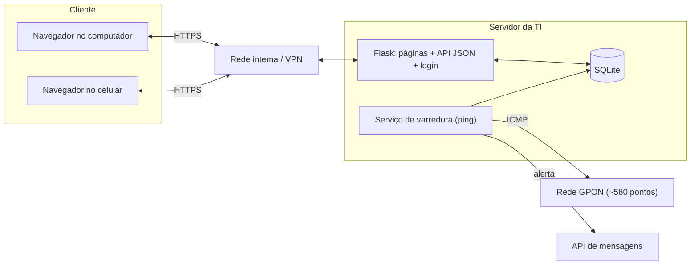
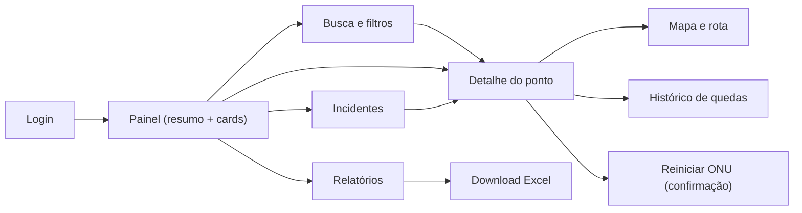
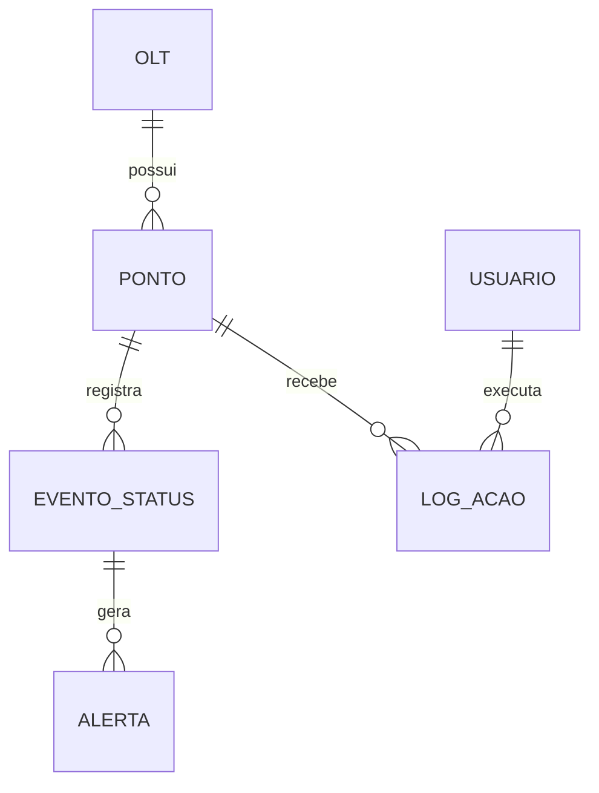

# Arquitetura inicial do painel web

Planejamento da Sprint 01 (card W01). Os diagramas serão revisados ao longo das sprints.

## Visão geral (cliente-servidor)

## Fluxo de navegação

## Modelo de dados

## MVP
Login (RF01), painel com cards e atualização automática (RF02), busca e filtros (RF03),
detalhe do ponto (RF04) e mapa com rota (RF05), acessíveis em computador e celular.
